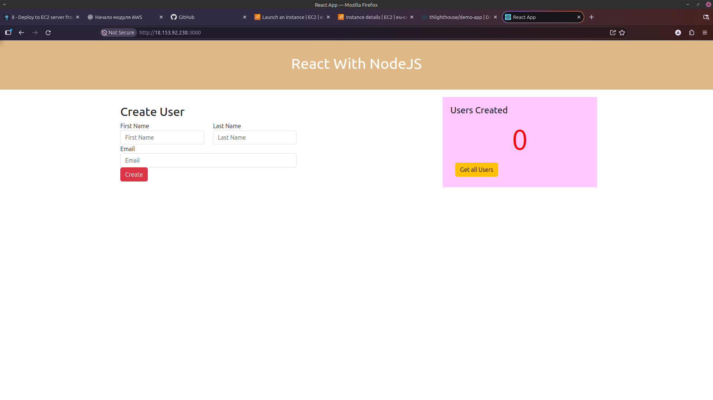

# Manual Deployment of a Dockerized Application to AWS EC2

This is a hands-on project completed during the **AWS Services** module of the TechWorld with Nana DevOps Bootcamp.

The goal was to deploy a web application on an AWS EC2 instance manually. I built the Docker image on my local machine, pushed it to Docker Hub, prepared an EC2 server, and ran the application in a container there.

> The React/Node.js application and starter Dockerfile were provided as part of the TechWorld with Nana DevOps Bootcamp. This README documents my own deployment, configuration, and troubleshooting while following the course.

## Technologies used

- AWS EC2 and Security Groups
- Ubuntu Linux
- Docker and Docker Hub
- Node.js and Express
- React
- Git and GitHub

## Application overview

The application has a React frontend and a Node.js/Express backend. It provides a simple form for creating users and a button for retrieving the user list.

The backend stores users in a JavaScript array in memory. There is no database in this demo, so user data is not preserved if the server or container restarts.

The provided `Dockerfile` uses a multi-stage build: the first stage builds the React frontend with `node:24-alpine`, and the second stage installs the API dependencies, copies the frontend build, and runs the Node.js server. The application listens on port `3080`.

## Building and testing the image locally

After cloning the starter repository, I built a Docker image from the project root:

```bash
docker build -t react-nodejs-app:1.0 .
```

I then ran the container with port `3080` published on my local machine:

```bash
docker run -d \
  --name react-nodejs-container \
  -p 3080:3080 \
  react-nodejs-app:1.0
```

I checked that the container was running with `docker ps` and opened the application at `http://localhost:3080`.

## Pushing the image to Docker Hub

I used my existing Docker Hub repository for Bootcamp images and gave this project its own tag, `aws-ec2-1.0`.

```bash
docker login -u thlighthouse

docker tag react-nodejs-app:1.0 thlighthouse/demo-app:aws-ec2-1.0

docker push thlighthouse/demo-app:aws-ec2-1.0
```

The `docker tag` command added another name and tag to the same local image; it did not rebuild it.

Docker Hub image: [`thlighthouse/demo-app:aws-ec2-1.0`](https://hub.docker.com/r/thlighthouse/demo-app/tags?name=aws-ec2-1.0)

## Preparing the AWS EC2 instance

Next, I launched an Ubuntu EC2 instance in AWS and connected to it through SSH. On the server, I updated the system packages and installed Docker.

I configured the EC2 Security Group to allow inbound TCP traffic on port `3080` from **my own public IP address**. This allowed me to reach the application from my browser without opening the application port to the entire internet.

After installing Docker, I verified that it was available:

```bash
sudo docker --version
```

## Pulling and running the image on EC2

On the EC2 instance, I authenticated with my **Docker Hub username**, then pulled the same image that I had published from my laptop:

```bash
sudo docker login -u thlighthouse

sudo docker pull thlighthouse/demo-app:aws-ec2-1.0
```

I ran the image as a Docker container and mapped port `3080` on the EC2 host to port `3080` inside the container:

```bash
sudo docker run -d \
  --name react-nodejs-app \
  -p 3080:3080 \
  thlighthouse/demo-app:aws-ec2-1.0
```

These commands are useful for checking the container afterward:

```bash
sudo docker ps
sudo docker logs react-nodejs-app
```

## Deployment result

I opened the application in my browser using the EC2 instance's public IPv4 address and port `3080`:

```text
http://<EC2_PUBLIC_IP>:3080
```

The React application loaded successfully from the remote EC2 instance.



I use `<EC2_PUBLIC_IP>` as a placeholder in the commands because the public address can change when an EC2 instance does not have a static Elastic IP.

## Troubleshooting

### The container started, but localhost:3080 did not work

At first, I started the container without a port mapping. The container existed, but the application was not reachable through `localhost:3080`.

I learned that `EXPOSE 3080` in the Dockerfile only documents the container's port; it does not publish that port to the host. I removed the old container and created a new one with `-p 3080:3080`. There was no need to delete or rebuild the Docker image.

### Docker Hub login failed on EC2

My first login attempt used the repository path instead of the account username:

```bash
sudo docker login -u thlighthouse/demo-app
```

That failed. The correct username is `thlighthouse`; `demo-app` is the repository name. After correcting the login command, I was able to authenticate and pull the image.

## What I learned

This project brought together several topics I had already practiced separately: Docker image builds, registry authentication, Linux server administration, and AWS networking.

The most valuable part was following the entire deployment process myself, from the application source code on my laptop to a running container on a remote EC2 server. I also got practical experience with Docker port mapping, image tags, Security Groups, and troubleshooting deployment problems.

This was a **manual deployment**, without Jenkins or an automated CI/CD pipeline. In the following AWS projects, I will build on these steps by deploying applications to EC2 automatically through Jenkins.

This is a learning environment rather than a production deployment: the application is served over HTTP and the sample backend does not persist user data.